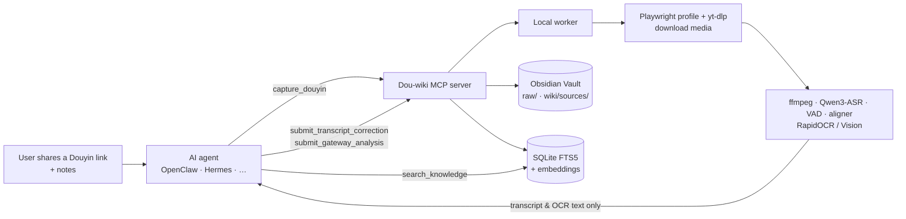

<div align="center">


**English** · [简体中文](README.zh-CN.md)

**A local Douyin knowledge base for AI agents.**<br>
Turn Douyin videos and image notes into searchable, source-linked Obsidian Markdown on your Mac — driven by your agent over MCP.

[](LICENSE)
[](pyproject.toml)
[](docs/gateway-agents.md)
[](#requirements)
[](https://github.com/WYgao29/Dou-wiki/commits/main)


</div>

## Contents

[Why](#why) · [Features](#features) · [How it works](#how-it-works) · [Quickstart](#quickstart) · [Agent integration](#use-it-from-your-agent) · [Screenshots](#screenshots) · [FAQ](#faq) · [Roadmap](#roadmap) · [Contributing](#contributing) · [License](#license)

## Why

Short videos carry a lot of useful knowledge — tutorials, explanations, recommendations — but it stays locked inside a feed: hard to search, hard to cite, and gone when you need it. Pasting a link into a chat model doesn't help: the model can't watch the video, and nothing is kept.

抖库 Dou-wiki does the heavy media work **locally** (download, speech recognition, OCR), then hands only the text to the model your agent is *already* using, to correct and analyze it. The result is a durable knowledge base you own, where every point links back to the original work with a timestamp or image number.

## Features

| | Feature | Details |
|---|---|---|
| 🤖 | **Agent-first MCP server** | `douyin-wiki-mcp` over STDIO: `capture_douyin`, `capture_douyin_creator`, `capture_douyin_collection`, `get_job`, `get_analysis_context`, `submit_transcript_correction`, `submit_gateway_analysis`, `search_knowledge`, `get_entry`, `list_job_events`, and more. |
| 🔗 | **Capture from share text** | Extracts the short link from a pasted Douyin share message and detects video vs. image note. |
| 👤 | **Creators, collections, favorites** | Inventory a creator's public works, a full paginated collection, or your favorites; pick what to import; durable, resumable batch jobs. |
| 🎙️ | **Local transcription & OCR** | Qwen3-ASR + Silero VAD + Qwen3 ForcedAligner on Apple Silicon (MLX); OCR via RapidOCR or macOS Vision. Pinned model revisions, safetensors only, no remote code. |
| 🧠 | **Gateway analysis, no API keys** | The worker pauses after transcription; your agent's own model corrects the transcript and submits a structured analysis. The video is never uploaded to the model. |
| 📝 | **Obsidian output** | Immutable `raw/` records, one-screen `wiki/sources/` pages, concept/entity wikilinks, content-type cards, and a chapter-by-chapter timeline for videos, with cover images. |
| 🔍 | **Evidence search** | SQLite FTS5 + optional local embeddings (`BAAI/bge-small-zh-v1.5`, falls back to character n-grams); results carry source links and timestamps / image numbers. |
| 🖥️ | **Local Web UI** | Bound to `127.0.0.1`: library, reader, keyframe gallery, keyword / semantic search, tags, imports and jobs. |
| 🧹 | **Maintenance** | Weekly stale-content and orphan-page checks, media retention policies, optional macOS Reminders. |

## How it works



The MCP server and worker run on your Mac. Only text (transcript, OCR, page text) goes to the agent's model; every result is written to your Vault and indexed for search.

## Quickstart

### Requirements

- macOS, Apple Silicon for Qwen3-ASR (the `mlx` / `qwen3` extras)
- Python 3.12–3.13, [`uv`](https://github.com/astral-sh/uv), `ffmpeg`
- Obsidian (recommended for reading the Vault)

### Install (development)

The project is now **抖库 Dou-wiki**. The Python package, `douyin-wiki` / `douyin-wiki-mcp` commands, MCP server name, configuration paths and environment variables keep their existing identifiers. The explicit clone directory below preserves the existing setup commands.

```bash
git clone https://github.com/WYgao29/Dou-wiki.git douyin-wiki
cd douyin-wiki
uv sync --locked --extra dev --extra embeddings --extra asr --extra ocr --extra mlx
uv run --no-sync python -m playwright install chromium
uv run --no-sync douyin-wiki init      # interactive: create a new Vault or attach an existing one
uv run --no-sync douyin-wiki doctor    # checks dependencies, models, browser and Vault
```

`init` creates only missing folders and templates and never overwrites existing notes or Obsidian settings. For unattended setup: `douyin-wiki init --vault /absolute/path/to/抖库`.

Download the pinned speech models once; transcription itself then stays offline:

```bash
uv run --no-sync hf download mlx-community/Qwen3-ASR-1.7B-bf16 --revision e1f6c266914abc5a46e8756e02580f834a6cf8a7 --include '*.safetensors' --include '*.json' --include '*.txt'
uv run --no-sync hf download mlx-community/silero-vad --revision 7bc17f22d3c0451bd3a6cd71e759b009271ff49a --include '*.safetensors' --include '*.json' --include '*.txt'
uv run --no-sync hf download mlx-community/Qwen3-ForcedAligner-0.6B-8bit --revision 0e1a68e91d815300c7c9754b2a7639378b23db15 --include '*.safetensors' --include '*.json' --include '*.txt'
```

Optional embeddings: `hf download BAAI/bge-small-zh-v1.5`. Set `HF_ENDPOINT` if you need a mirror.

### Run

```bash
uv run --no-sync douyin-wiki auth douyin              # sign in once in the dedicated browser profile
uv run --no-sync douyin-wiki worker run --forever     # or: douyin-wiki service install
uv run --no-sync douyin-wiki web open                 # optional local Web UI
```

### Default locations

| What | Path |
|---|---|
| Config | `~/Library/Application Support/douyin-wiki/config.toml` |
| Vault | `~/Documents/Obsidian/抖库` (existing Vaults are not renamed or moved) |
| State DB | `<Vault>/.douyin-wiki/state.sqlite3` |
| Browser profile | `~/Library/Application Support/douyin-wiki/browser-profile/` |

<details>
<summary><b>Production install (wheel in a separate runtime, mirror-friendly)</b></summary>

Production runs from a built wheel installed into a runtime outside the repo; the worker, maintenance, Web UI and MCP should all share it. To install through a mirror while keeping locked versions and hashes:

```bash
uv export --locked --no-dev --extra asr --extra ocr --extra embeddings --no-emit-project --output-file /absolute/path/douyin-requirements.txt
uv venv /absolute/path/douyin-runtime
uv pip install --python /absolute/path/douyin-runtime/bin/python --require-hashes --index-url https://pypi.tuna.tsinghua.edu.cn/simple -r /absolute/path/douyin-requirements.txt
uv pip install --python /absolute/path/douyin-runtime/bin/python --no-deps /absolute/path/douyin_wiki.whl
```

Install the Playwright browser separately with `python -m playwright install chromium` (`PLAYWRIGHT_DOWNLOAD_HOST` for a custom source). See [`docs/agents/quickstart.md`](docs/agents/quickstart.md).

</details>

## Use it from your agent

Register the STDIO MCP server in your client:

```json
{
  "command": "/abs/path/runtime/.venv/bin/python",
  "args": ["-B", "-m", "douyin_wiki.mcp_server"],
  "env": {
    "PYTHONDONTWRITEBYTECODE": "1",
    "DOUYIN_WIKI_CONFIG": "/abs/path/config.toml",
    "DOUYIN_WIKI_BROWSER_PROFILE": "/abs/path/browser-profile"
  }
}
```

Typical flow:

1. `capture_douyin` with the share text (and the user's notes as `inspirations`) → returns a `job_id`.
2. Poll `get_job(job_id, gateway_protocol=2)`.
3. Videos: `get_analysis_context` → `submit_transcript_correction`; then `get_analysis_context` again → `submit_gateway_analysis`. Each submit carries the latest `context_revision`.
4. On completion, `get_entry` for the result; later, `search_knowledge` to answer questions with cited evidence.

Creators, collections and favorites use `capture_douyin_creator`, `capture_douyin_collection` and the favorites tools. Full contract: [Gateway guide](docs/gateway-agents.md) · [Integration contract](docs/agents/integration-contract.md).

## Screenshots

| Reader with timeline & source info | Job center |
|---|---|
|  |  |
| **Synced creators** | **Generated Obsidian note (Markdown source)** |
|  |  |

Screenshots are from a real local install (Web 0.2.83) with public Douyin tech content.

## FAQ

<details><summary><b>Does it need an OpenAI / Anthropic API key?</b></summary>

No. The tool stores no model keys. Correction and analysis are done by the model of the agent that calls it ("gateway" mode, the only supported mode).
</details>

<details><summary><b>Is my video uploaded anywhere?</b></summary>

No. Media is downloaded and processed on your Mac; only extracted text is passed to the agent. Media is kept 30 days by default (keyframes kept long-term on new installs), configurable per request with `retention` / `keep_keyframes`.
</details>

<details><summary><b>Does it touch my everyday Chrome profile?</b></summary>

No. Capture uses a dedicated Playwright profile. Only as a last resort, when no media URL can be obtained, can it fall back to system Chrome cookies.
</details>

<details><summary><b>Why can't I create captures from the Web UI or CLI?</b></summary>

Since 0.2, all business actions go through MCP so the agent can finish correction and analysis in the same conversation. The Web UI manages existing batches, jobs, reading and tags; retired CLI commands (`capture`, `search`, …) exit with code `2` and point to the MCP tool.
</details>

<details><summary><b>Which languages are supported?</b></summary>

Chinese and mixed Chinese–English are tested. Other languages need support in both the recognizer and the aligner.
</details>

## Roadmap

- [ ] English agent guide and docs
- [ ] Prebuilt wheel releases on GitHub
- [ ] Demo Vault and end-to-end demo video
- [ ] ASR / OCR backends beyond macOS and Apple Silicon
- [ ] More agent clients documented and tested
- [ ] Automated tests in CI

## Contributing

Issues and PRs are welcome. Please read [`AGENTS.md`](AGENTS.md), [`docs/architecture.md`](docs/architecture.md) and [`docs/troubleshooting.md`](docs/troubleshooting.md) first, and lint with `ruff`. Keep changes local-first: no media goes to models, and the tool stores no API keys.

## License

[MIT](LICENSE) © 2026 WYgao29.
Model weights are not distributed and follow their upstream licenses: [Qwen3-ASR](https://github.com/QwenLM/Qwen3-ASR) / ForcedAligner (Apache-2.0), [Silero VAD](https://github.com/snakers4/silero-vad) (MIT; MLX conversion cards declare no license), [RapidOCR](https://github.com/RapidAI/RapidOCR).
