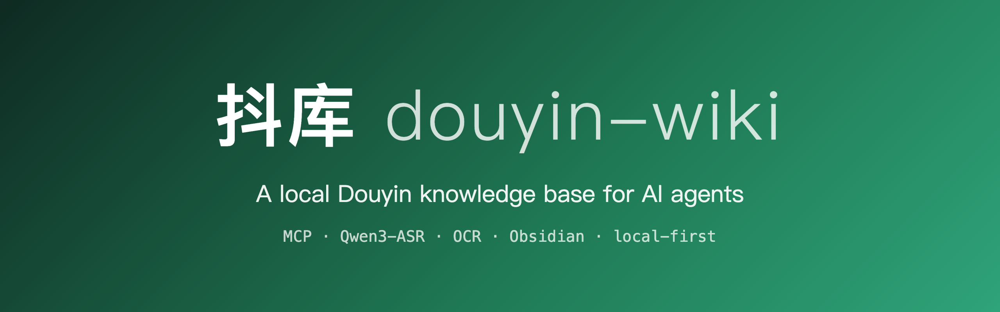
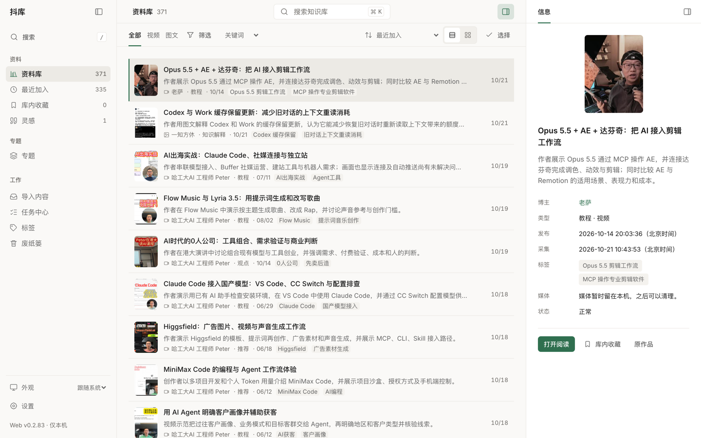
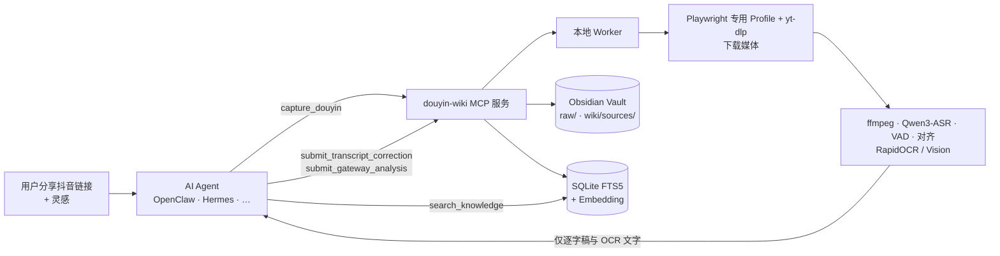
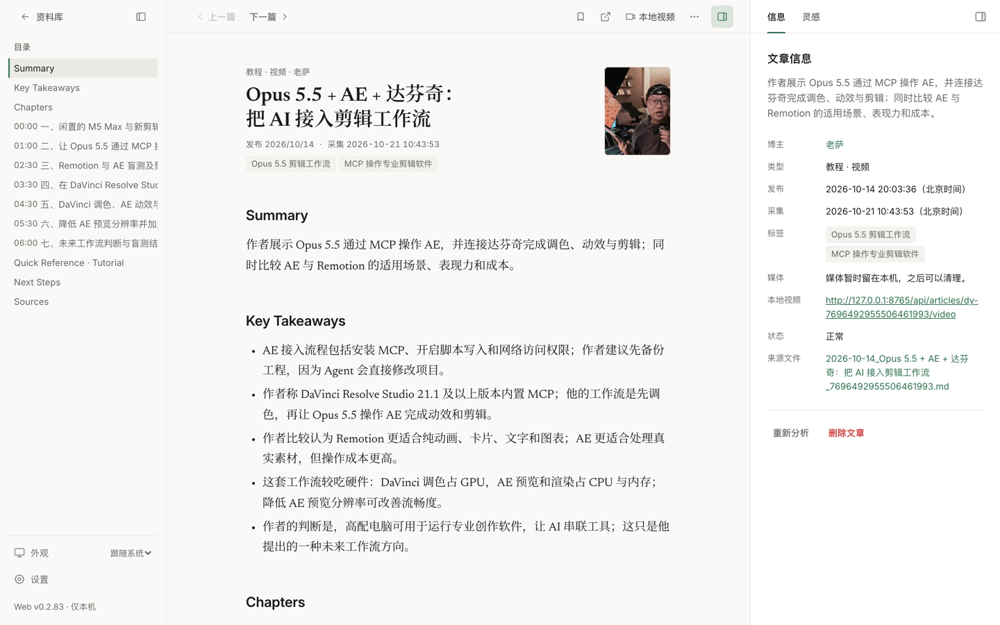
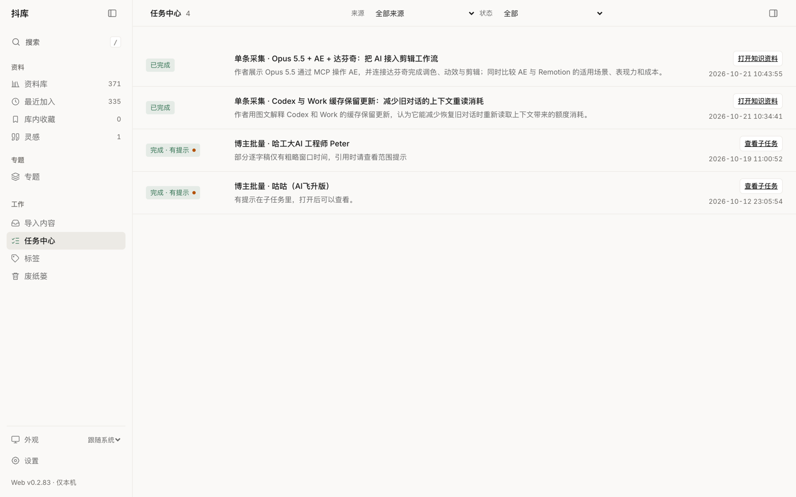
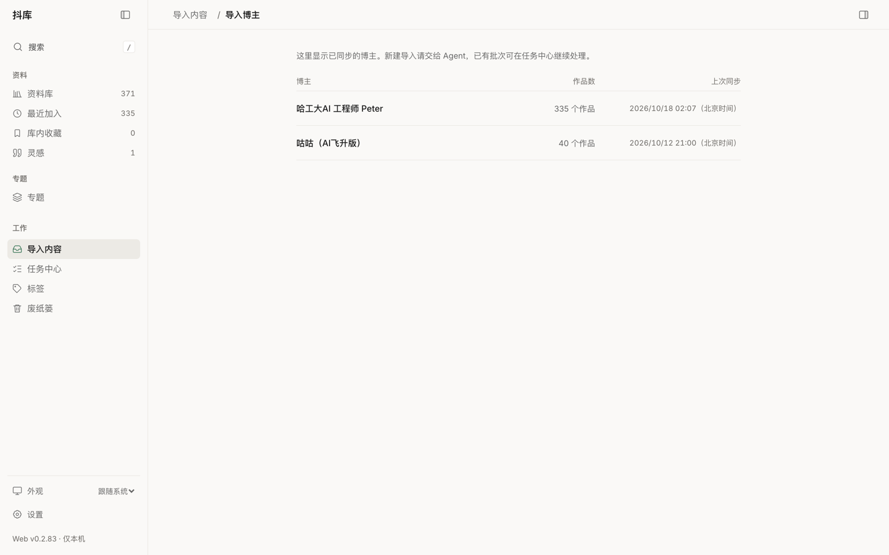
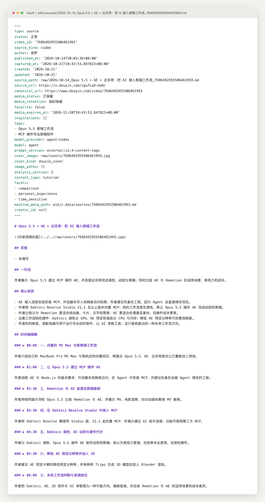

<div align="center">



[English](README.md) · **简体中文**

**面向 AI Agent 的本地抖音知识库。**<br>
在你的 Mac 上，由 Agent 通过 MCP 驱动，把抖音视频和图文变成可搜索、可溯源的 Obsidian Markdown。

[](LICENSE)
[](pyproject.toml)
[](docs/gateway-agents.md)
[](#环境要求)
[](https://github.com/WYgao29/douyin-wiki/commits/main)



</div>

## 目录

[为什么](#为什么) · [功能](#功能) · [工作原理](#工作原理) · [快速开始](#快速开始) · [Agent 接入](#在-agent-中使用) · [截图](#截图) · [常见问题](#常见问题) · [路线图](#路线图) · [参与贡献](#参与贡献) · [许可证](#许可证)

## 为什么

短视频里有大量有用的知识——教程、解释、推荐——但它们困在信息流里：难搜索、难引用，需要时找不到。把链接贴给聊天模型也没用：模型看不了视频，也不会留下任何东西。

抖库（douyin-wiki）在**本地**完成繁重的媒体处理（下载、语音识别、OCR），只把文字交给 Agent *正在使用*的模型做校正与分析。结果是一个归你所有的长期知识库，每个要点都能通过时间戳或图片编号追溯到原作品。

## 功能

| | 功能 | 说明 |
|---|---|---|
| 🤖 | **Agent 优先的 MCP 服务** | 通过 STDIO 提供 `douyin-wiki-mcp`：`capture_douyin`、`capture_douyin_creator`、`capture_douyin_collection`、`get_job`、`get_analysis_context`、`submit_transcript_correction`、`submit_gateway_analysis`、`search_knowledge`、`get_entry`、`list_job_events` 等。 |
| 🔗 | **从分享文案采集** | 从整段抖音分享文案中提取短链，自动识别视频或图文作品。 |
| 👤 | **博主、合集、收藏** | 清点博主全部公开作品、完整分页合集或你的收藏；选择后导入；任务持久、可恢复。 |
| 🎙️ | **本地转录与 OCR** | 在 Apple Silicon（MLX）上运行 Qwen3-ASR + Silero VAD + Qwen3 ForcedAligner；OCR 使用 RapidOCR 或 macOS Vision。固定模型版本，只加载 safetensors，不执行远端代码。 |
| 🧠 | **Gateway 分析，无需 API 密钥** | Worker 转录后暂停，由 Agent 自己的模型校正逐字稿并提交结构化分析。原视频不上传给模型。 |
| 📝 | **Obsidian 输出** | 不可变 `raw/` 记录、一屏 `wiki/sources/` 精华页、概念 / 实体 wikilink、按内容类型选择的知识卡片，以及带封面的视频章节“时间轴图解”。 |
| 🔍 | **证据检索** | SQLite FTS5 + 可选本地 Embedding（`BAAI/bge-small-zh-v1.5`，缺失时使用字符 n-gram）；结果附原作品链接和时间戳 / 图片编号。 |
| 🖥️ | **本机 Web** | 仅绑定 `127.0.0.1`：资料库、阅读器、关键帧画廊、关键词 / 语义搜索、标签、导入与任务。 |
| 🧹 | **维护** | 每周标记过期内容、检查孤立页面，媒体保留策略，可选 macOS 提醒事项。 |

## 工作原理



MCP 服务和 Worker 运行在你的 Mac 上。只有文字（逐字稿、OCR、页面文字）会交给 Agent 的模型；所有结果写入你的 Vault 并建立检索索引。

## 快速开始

### 环境要求

- macOS；Qwen3-ASR 需要 Apple Silicon（`mlx` / `qwen3` extras）
- Python 3.12–3.13、[`uv`](https://github.com/astral-sh/uv)、`ffmpeg`
- Obsidian（推荐，用于阅读 Vault）

### 安装（开发环境）

```bash
git clone https://github.com/WYgao29/douyin-wiki.git
cd douyin-wiki
uv sync --locked --extra dev --extra embeddings --extra asr --extra ocr --extra mlx
uv run --no-sync python -m playwright install chromium
uv run --no-sync douyin-wiki init      # 交互式：新建独立 Vault 或使用已有 Vault
uv run --no-sync douyin-wiki doctor    # 检查依赖、模型、浏览器和 Vault
```

`init` 只创建缺失的目录与模板，不覆盖已有笔记或 Obsidian 配置。无人值守安装：`douyin-wiki init --vault /absolute/path/to/抖库`。

首次准备固定版本的语音模型；之后转写全程离线：

```bash
uv run --no-sync hf download mlx-community/Qwen3-ASR-1.7B-bf16 --revision e1f6c266914abc5a46e8756e02580f834a6cf8a7 --include '*.safetensors' --include '*.json' --include '*.txt'
uv run --no-sync hf download mlx-community/silero-vad --revision 7bc17f22d3c0451bd3a6cd71e759b009271ff49a --include '*.safetensors' --include '*.json' --include '*.txt'
uv run --no-sync hf download mlx-community/Qwen3-ForcedAligner-0.6B-8bit --revision 0e1a68e91d815300c7c9754b2a7639378b23db15 --include '*.safetensors' --include '*.json' --include '*.txt'
```

可选 Embedding：`hf download BAAI/bge-small-zh-v1.5`。需要镜像时设置 `HF_ENDPOINT`。

### 运行

```bash
uv run --no-sync douyin-wiki auth douyin              # 在专用浏览器 Profile 中登录一次
uv run --no-sync douyin-wiki worker run --forever     # 或：douyin-wiki service install
uv run --no-sync douyin-wiki web open                 # 可选：本机 Web
```

### 默认位置

| 内容 | 路径 |
|---|---|
| 配置 | `~/Library/Application Support/douyin-wiki/config.toml` |
| Vault | `~/Documents/Obsidian/抖库`（已有 Vault 不自动改名或移动） |
| 状态库 | `<Vault>/.douyin-wiki/state.sqlite3` |
| 浏览器 Profile | `~/Library/Application Support/douyin-wiki/browser-profile/` |

<details>
<summary><b>正式安装（独立 runtime 中的 wheel，适合使用镜像）</b></summary>

正式运行使用构建好的 wheel，安装到仓库外的独立 runtime；Worker、维护、Web 和 MCP 应共用它。通过镜像安装并保留锁定版本与哈希：

```bash
uv export --locked --no-dev --extra asr --extra ocr --extra embeddings --no-emit-project --output-file /absolute/path/douyin-requirements.txt
uv venv /absolute/path/douyin-runtime
uv pip install --python /absolute/path/douyin-runtime/bin/python --require-hashes --index-url https://pypi.tuna.tsinghua.edu.cn/simple -r /absolute/path/douyin-requirements.txt
uv pip install --python /absolute/path/douyin-runtime/bin/python --no-deps /absolute/path/douyin_wiki.whl
```

Playwright 浏览器单独执行 `python -m playwright install chromium` 安装（自定义来源设置 `PLAYWRIGHT_DOWNLOAD_HOST`）。详见 [`docs/agents/quickstart.md`](docs/agents/quickstart.md)。

</details>

## 在 Agent 中使用

在客户端注册 STDIO MCP 服务：

```json
{
  "command": "/abs/path/runtime/.venv/bin/python",
  "args": ["-B", "-m", "douyin_wiki.mcp_server"],
  "env": {
    "PYTHONDONTWRITEBYTECODE": "1",
    "DOUYIN_WIKI_CONFIG": "/abs/path/config.toml",
    "DOUYIN_WIKI_BROWSER_PROFILE": "/abs/path/browser-profile"
  }
}
```

典型流程：

1. 用分享文案调用 `capture_douyin`（用户灵感逐字传入 `inspirations`）→ 返回 `job_id`。
2. 轮询 `get_job(job_id, gateway_protocol=2)`。
3. 视频：`get_analysis_context` → `submit_transcript_correction`；再次 `get_analysis_context` → `submit_gateway_analysis`。每次提交携带最新的 `context_revision`。
4. 完成后用 `get_entry` 获取结果；之后用 `search_knowledge` 带证据回答问题。

博主、合集和收藏分别使用 `capture_douyin_creator`、`capture_douyin_collection` 和收藏相关工具。完整协议：[Gateway 指南](docs/gateway-agents.md) · [接入契约](docs/agents/integration-contract.md)。

## 截图

| 阅读器：时间轴与来源信息 | 任务中心 |
|---|---|
|  |  |
| **已同步博主** | **生成的 Obsidian 笔记（Markdown 源文件）** |
|  |  |

截图来自真实本地安装（Web 0.2.83），内容为公开的抖音科技类作品。

## 常见问题

<details><summary><b>需要 OpenAI / Anthropic API 密钥吗？</b></summary>

不需要。工具不保存任何模型密钥。校正与分析由调用它的 Agent 的模型完成（“gateway”模式，也是唯一支持的模式）。
</details>

<details><summary><b>我的视频会被上传吗？</b></summary>

不会。媒体在你的 Mac 上下载和处理，只有提取出的文字交给 Agent。媒体默认保留 30 天（新安装默认长期保留关键帧），可按请求通过 `retention` / `keep_keyframes` 调整。
</details>

<details><summary><b>会动我日常使用的 Chrome Profile 吗？</b></summary>

不会。采集使用专用 Playwright Profile。只有在拿不到媒体地址时，才会作为最后手段读取系统 Chrome 的 Cookie。
</details>

<details><summary><b>为什么不能在 Web 或 CLI 中创建采集？</b></summary>

从 0.2 起，所有业务操作都通过 MCP 进行，让 Agent 在同一会话中完成校正与分析。Web 管理已有批次、任务、阅读和标签；已停用的 CLI 命令（`capture`、`search` 等）以退出码 `2` 返回，并指向对应的 MCP 工具。
</details>

<details><summary><b>支持哪些语言？</b></summary>

中文和中英混合已实测。其他语言需要识别器与对齐器同时支持。
</details>

## 路线图

- [ ] 英文版 Agent 指南与文档
- [ ] 在 GitHub 发布预构建 wheel
- [ ] 演示 Vault 与端到端演示视频
- [ ] 支持 macOS 与 Apple Silicon 以外的 ASR / OCR 后端
- [ ] 记录并测试更多 Agent 客户端
- [ ] CI 自动化测试

## 参与贡献

欢迎提交 Issue 和 PR。请先阅读 [`AGENTS.md`](AGENTS.md)、[`docs/architecture.md`](docs/architecture.md) 和 [`docs/troubleshooting.md`](docs/troubleshooting.md)，并使用 `ruff` 检查代码。保持本地优先：媒体不交给模型，工具不保存 API 密钥。

## 许可证

[MIT](LICENSE) © 2026 WYgao29。
项目不分发模型权重，权重遵循各自上游许可：[Qwen3-ASR](https://github.com/QwenLM/Qwen3-ASR) / ForcedAligner（Apache-2.0）、[Silero VAD](https://github.com/snakers4/silero-vad)（MIT；MLX 转换模型卡未声明许可）、[RapidOCR](https://github.com/RapidAI/RapidOCR)。
