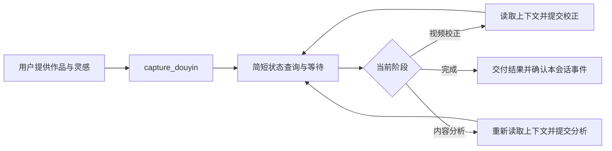

# 已安装服务的简明接入路径

适用于已有独立 runtime、配置、schema 16 Vault 和专用浏览器 Profile 的用户。尚未安装时先按[发行包安装](../../README.md#本地发行包与运行安装)准备；客户端配置和所有运行文件均放在仓库外。

## 1. 探测已安装环境

使用实际 runtime 的 Python，保留虚拟环境入口，替换以下路径。`doctor` 检查依赖、模型和临时浏览器启动，不访问抖音、不开始登录。

```bash
DOUYIN_WIKI_CONFIG='/绝对路径/config.toml' \
  '/绝对路径/runtime/.venv/bin/python' -B -m douyin_wiki doctor
```

先确认配置文件实际存在，检查输出的 Vault 与运行解释器。Worker、Web、维护和 MCP 应使用同一独立 runtime 和配置；已在后台运行 Worker 时无需再启动一份。需要前台常驻处理时，使用同一个配置执行 `python -B -m douyin_wiki worker run --forever`。本步骤不初始化旧库、不同步现用依赖。

## 2. 在客户端注册 STDIO MCP

STDIO 指客户端通过本地进程的标准输入 / 输出调用工具。按客户端当前支持的字段映射下面的逻辑模板；占位符均替换成真实绝对路径，JSON 不会自动展开变量。

```json
{
  "command": "/绝对路径/runtime/.venv/bin/python",
  "args": ["-B", "-m", "douyin_wiki.mcp_server"],
  "cwd": "/仓库外/当前实例/work",
  "env": {
    "PYTHONDONTWRITEBYTECODE": "1",
    "DOUYIN_WIKI_CONFIG": "/绝对路径/config.toml",
    "DOUYIN_WIKI_BROWSER_PROFILE": "/绝对路径/专用Profile"
  }
}
```

重连后读取 `tools/list` 和服务 instructions，开放实际返回的全部工具，并让客户端加载[Gateway 指南](../gateway-agents.md)。连接成功不表示共用规则已经加载。不要按角色限制工具，也不要用固定数量判断客户端占用多少上下文。客户端字段与完整验收见[接入契约](integration-contract.md#stdio-启动契约)。

## 3. 在当前会话完成一条任务



| 目的 | 常用工具与规则 |
| --- | --- |
| 提交作品 | `capture_douyin`，逐字传 `inspirations`，有保留诉求时显式传 `retention` / `keep_keyframes` |
| 查看状态 | `get_job(job_id, gateway_protocol=2)`，先确认当前 schema 支持 2；处理时等待后继续，不反复读全文 |
| 校正 / 分析 | `get_analysis_context` → 当前阶段对应的提交工具；两次提交使用各自最新 `context_revision` |
| 获取成果 | 终态回执需要补充时调用一次 `get_entry`，保留原作品链接与质量提示 |
| 处理事件 | `list_job_events` 逐页找本会话事件，成功处理或交付后才 `acknowledge_job_event` |
| 已有任务失败 | 先读实际错误，在原授权范围内修正输入或 `retry_job`；取消后不自动重试 |

作品调用参数示例，分享文本和会话路由替换成当前真实值：

```json
{
  "share_text": "用户给出的完整分享文本",
  "inspirations": [],
  "retention": "temporary",
  "keep_keyframes": true,
  "gateway_context": {
    "gateway": "当前客户端的独立标识",
    "channel": "当前渠道",
    "conversation_id": "当前会话编号"
  }
}
```

收到 `job_id` 后持续完成当前任务。视频通常先校正再分析，图文可直接分析；具体提交内容以刚读取的 schema 为准，不能复制示例事实代替作品材料。粗略时间保留实际窗口和“时间未经精确对齐”的说明，歌词不自动当作作者发言。

有 `gateway_context` 的任务会产生路由事件。即使主要用 `get_job` 跟进，也要在阶段处理或最终交付后确认自己的相关事件；其他客户端的事件继续翻页并跳过，不确认。终态交付后停止该任务的轮询。

## 4. 需要会话结束后继续时

只有用户需要后台继续时，再核对客户端原生唤醒能力或仓库外事件桥。当前会话的状态查询和回复无需后台桥；后台运行本地 Worker 也不会自动唤醒已结束的 Agent。重启、游标和重试规则见[事件接续](../gateway-agents.md#事件接续)。
