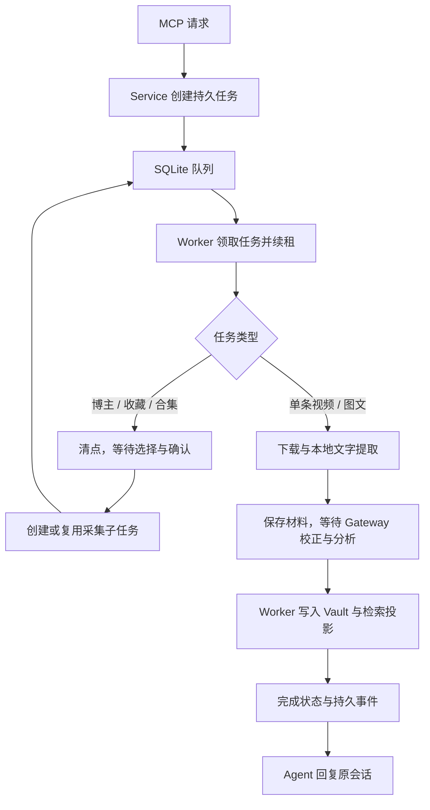

# 项目结构与处理流程

## 入口与分析模式

0.2.0 通过 MCP 创建业务请求，由 `DouyinWikiService` 写入持久任务。Web 管理已有批次和任务、阅读资料、灵感和专题笔记；CLI 保留安装、授权、运行和维护。业务 CLI 及 Web 新建请求已停用。

校正与分析只使用 `analysis_mode="gateway"`。本地 Worker 不持有会话、不调用对话模型；新视频转写后等待校正提交，再等待分析提交，静态图文 OCR 后直接等待分析。重新分析使用已保存材料。没有 provider/local 后端、Web 聊天或专题自动生成。

Gateway 的可选 `gateway_protocol` 默认 `1`，新调用优先显式使用 `2`。协议 2 使用分阶段上下文、OCR 投影、增量校正、证据引用和简短状态，独立于 `analysis_version=2`。`gateway_sources.py` 处理材料及原始范围，`gateway_protocol.py` 构造 schema、材料版本和回执；`service_analysis.py` 检查阶段、版本及并发状态，展开引用后校验原始材料。原稿、OCR、校正稿和标准分析持久存储不变，编号不进入 Vault。调用顺序见[Gateway 指南](gateway-agents.md#紧凑协议gateway_protocol2)。



视频优先通过专用 Playwright Profile 获取媒体地址，再由下载工具保存；失败时回退到页面下载。音轨只由 Qwen3-ASR 转录，使用 Silero 判断静音、ForcedAligner 计算时间，流式识别窗口最多 600 秒，主对齐窗口最多 180 秒，展示段默认最多 30 秒。源样本与字符归属完整；异常预测的有界重新对齐仍保持原文和严格时间检查，不能返回部分成功结果。视频抽帧与静态图文由 OCR 后端识字；`auto` 优先 RapidOCR，初始化不可用时使用 Vision。已知旧 ASR 配置字段在内存中转换为当前识别设置，不迁移旧业务数据；新库保存的材料支持正常恢复。详情见根目录 README。

不超过 180 秒的音轨无需锚点切分。长音轨的主对齐切点优先选择句间停顿中点；少量识别文字配长静音时，识别仍读取完整音轨，只按完整 VAD 扫描裁去对齐输入两端的长静音，并恢复文件绝对时间。局部修复最多尝试四次，按模型尝试计数，一次预测可修复多组异常词；30 秒锚点过短时扩展至 60 秒，重复词异常可用保留词时间定位原文短上下文。所有实际替换词继续经过原有时间和原文检查，其他局部异常词不覆盖已有有效预测。当前识别记录标记为 `qwen3-anchored-alignment-v2`。

停顿中点不符合时间限制时，在停顿与合法时间范围的交集内选点；名义切点前后 15 秒、两侧窗口不超过 180 秒及数词保护继续执行。一次局部预测中的主词组必须通过检查；附加组缺少邻词或无法衔接时保留原状态，留给后续预测，不丢弃主组的有效修复。严格模式只有全部异常词修复且整段校验通过，才返回完整对齐结果。

`alignment_failure_policy="retain_window"` 可在全文识别成功后，仅对允许的对齐错误保留整个真实识别窗口。`timestamp_precision="window"` 连同窗口范围和原因经过原稿、校正稿、Gateway、证据、检索、资料侧车及阅读器；服务端从原材料推导，Agent 不能把它改成精确时间。任务完成时带提示，资料正文也保留可读提示。缺该配置的已有安装继续使用 `fail`；首次 `init` 的新配置启用有限降级。音频损坏、识别不完整、覆盖异常等不降级。

识别与对齐的完整窗口按音频内容和相关模型/配置分别保存到工作目录，原子写入并校验摘要后复用；不发布部分逐字稿。帧提取和 OCR 在转写前独立保存，使用媒体内容及提取配置校验重试材料。资料保存、事务和 Worker 租约约束不变。

新视频由当前 Gateway Agent 直接校正后继续入库，普通 ASR/OCR 疑点只记录，不新增人工复核步骤。用户选定的视频直接处理，不因时长暂停；转写不设置整条音轨的总时长上限，仍按最多 600 秒的窗口逐块处理。公开的复核 / 确认状态及 `resolve_review` / `approve_job` 工具继续兼容，新库任务按实际状态处理；旧版本任务不迁移或接续。授权失效和 Gateway 提交错误仍按对应任务状态处理。

## 文件职责

以下模块路径相对于 `src/douyin_wiki/`。

| 文件或目录 | 职责 |
| --- | --- |
| `cli.py`、`mcp_server.py`、`webapp/` | CLI、MCP 和本机 Web 入口 |
| `worker.py`、`runtime.py` | 队列调度、租约续期、失效任务恢复、代码更新检测 |
| `service.py`、`service_*.py` | 服务门面；采集、分析、批量导入、资料、维护、废纸篓六个 mixin |
| `database.py`、`vault.py` | SQLite 持久状态与索引；Markdown、侧车和 Vault Git |
| `favorites.py`、`favorites_models.py`、`favorites_store.py` | 收藏清点、选择、幂等派发和批次汇总；数据契约及批次持久存储 |
| `collections.py`、`collection_models.py`、`collection_store.py` | 合集清点、逐条选择、原子确认、批次状态和持久合集关系 |
| `batch_capture.py` | 收藏、博主和合集共用的作品身份及活动任务查重 |
| `capture_sharing.py` | 短链解析后的活动采集复用、持久等待者、批次关联重指及结果同步 |
| `tags.py` | 标签、别名与资料关联；沿用数据库事务和解析约定 |
| `analysis_rules.py` | Gateway 校正 / 分析的提示版本、内容标签规则和数量上限 |
| `adapters/favorites.py` | 收藏清点的 Profile 锁、账号保护、目录与指定夹分页、去重和检查点；全部模式的 DOM 作品读取 |
| `adapters/favorites_api.py`、`adapters/favorites_browser.py` | 原始收藏 JSON 与稳定 ID 解析；网页原生只读请求、响应关联、重试预算和监听生命周期 |
| `adapters/collection.py`、`adapters/collection_api.py`、`adapters/collection_browser.py` | 专用 Profile、稳定账号保护、合集原生 GET、原始 JSON 与串行分页检查点 |
| `adapters/` | 抖音解析与下载、Qwen3 / OCR 媒体处理、向量和系统提醒适配 |
| `webapp/version.py` | Web 版本常量；`app.WEB_VERSION` 继续导出，包入口延迟加载 `create_app` / `run_web` |
| `search.py` | 证据分块、FTS 与向量检索、资料关系 |
| `web_auth.py`、`auth_guidance.py` | Web 授权会话与 macOS 授权引导 |
| `operation.py`、`web_operation.py` | 任务展示、授权状态与维护操作 |
| `config.py`、`setup.py` | Gateway 配置、安装检查与 LaunchAgent；不再使用对话模型密钥 |
| `models.py`、`errors.py` | 数据契约与稳定错误类型 |
| `localization.py`、`time_utils.py` | 面向用户的状态文案；时间解析、时区和显示转换 |

## 状态与数据

`DouyinWikiService.initialize()` 与 `initialize_runtime()` 先由 `Database.initialize()` 检查状态库版本，再进入 Vault 初始化、文件迁移及 Git 操作。数据库仍在取得 SQLite 写锁后再次检查版本；不受支持的状态库在任何 Vault 文件和目录被修改前拒绝。

用户 Vault 与源码仓库分离。Vault 保存不可变原始记录、可更新资料页、机器侧车和媒体；`.douyin-wiki/state.sqlite3` 保存任务、事件、授权会话及检索投影，没有聊天表。重建知识索引不等于恢复全部操作历史。

专题笔记的历史来源和资料关系可以引用已合法删除的资料。重建根据已完成的废纸篓日志识别这些引用；彻底删除前将精简身份凭据保存到 `wiki/.data/deleted-entries/<entry_id>.json`，不保留正文或媒体。历史关系留在侧车，目标不存在时不写入 SQL 关系表；当前专题来源仍须存在，未有合法删除证据的缺失或损坏资料仍拒绝重建。重新采集同一资料时移除旧的永久删除凭据。该可选目录兼容现有 Vault，无 schema 变更。

0.2.0 仅创建原生 schema 16 新库，旧版状态库明确拒绝，不自动迁移旧业务数据。新 schema 使用 `collections/collection_works` 保存知识关系，`collection_runs/collection_run_items` 保存批次世代、选择及子任务关联；博主运行项补充 `child_job_id`。`Database.capture_parent_ids()` 与 `batch_child_ids()` 查询真实关联，复用 capture 保留原 Gateway 上下文。确认先用 `CaptureOptions.processing_key()` 检查所有候选的有效处理选项，再在一个写事务中发布子任务；短链后来解析出的重复请求保留 ID 和 Gateway，进入持久等待状态，批次关联指向执行任务。取消保护依据其他活动父任务及独立等待者，完成刷新覆盖全部相关入口。

取消批次先按原 `creator/favorites/collection_context.parent_job_id` 撤销其共享等待记录，再依据实际父任务关系决定是否停止执行者；共享结果刷新不会恢复已取消的记录。等待者单独重试在同一状态更新事务中移除 artifacts 和 result 的旧执行者关联，普通重试保留检查点。Web 保留等待记录自身状态和请求，用实际执行者展示阶段、进度、授权范围及跳转入口；进行中与需要用户操作筛选依据当前共享执行状态。

合集清点只读取指定合集，不遍历博主的其他作品。稳定账号来自自身主页，Cookie 指纹只检测会话变化，不作为持久账号 ID。成员和顺序仅在完整读取后更新；部分发现另行标记。`collections/<首次名称>_<mix_id>/index.md` 与 `.data/collection.md` 保存可恢复关系，不保存账号、Cookie 或运行历史。用户删除、恢复和知识重建按作品 ID 重新关联，详情见[合集导入](collections-import.md)。

同一作品采集使用作品锁；条目修改使用跨进程操作锁。Worker 发布资料时在数据库写事务内校验租约，再写文档与检索投影。重新分析、恢复媒体等耗时操作在最终发布前重新读取当前条目，保留期间产生的用户修改。相关调用约定见 [Service 协作 API](service-collaboration-api.md)。

定期维护由独立 LaunchAgent 调度，Worker 启动时补偿错过的维护。维护处理知识过期、孤立页面和媒体保留，不自动同步博主或收藏。临时媒体按条目 `media_policy.keep_keyframes` 保存快照清理：为 `true` 时只保留作品 `assets/<id>/frames/`，其余视频、音轨和检查点移入系统废纸篓；旧条目缺标记仍清理整个素材目录。`keep / discard` 的整体策略保留，删除整条资料仍将帧一起移入资料废纸篓。Web 只监听本机回环地址。

`frames` 清单、`frame_manifest_version` 和媒体策略经机器侧车保存并可重建。阅读接口只列出当前作品真实存在的图片，不返回绝对路径；旧资料仅按可信文件名恢复时间，无法验证的时间显示未知。网页 `/api/library/search` 复用已有文字检索和向量索引，先按作者、类型、标签、来源、收藏批次或专题启用来源限定条目，再排序。没有本地语义模型或查询失败时返回带提示的关键词结果；空专题不扩大范围，只读 Markdown 的语义索引覆盖限制在界面说明。


收藏的原生新 schema 按作品保存 `selection_explicit`。增量清点比较同账号、同范围的更早批次，只继承手动明确选择或已确认批次选择；本批首次清点冻结 `_baseline_work_ids`，详情读取不补写数据库。收藏范围由 MCP 新建参数确定，Web 只管理已有批次。

共享只比较当前有效的 `retention`；`allow_long` 和 `approve_cloud_analysis` 继续接收，但不影响执行或共享。等待者保留原请求和 Gateway 上下文，材料读取和校正 / 分析提交使用 `result.shared_capture_job_id` 对应的执行任务。

## 开发验证

```bash
uv sync --locked --extra dev --extra embeddings
uv run --no-sync ruff check src tests
uv run --no-sync pytest -q -m 'not live'
```

`tests/conftest.py` 提供临时 Vault 与假适配器；`tests/support/web.py` 共用 Web 夹具、离线媒体适配器和带 Origin 的客户端，供正式测试及八个浏览器脚本调用。完整离线集有用例直接注入 `sentence_transformers`，因此验证环境也需 `embeddings` extra；该测试模拟模型初始化失败，不下载真实模型。浏览器回归使用隔离上下文和模拟网络。真实抖音冒烟需显式启用 `live`，前置条件见 `tests/test_live_smoke.py`。测试按接口、领域和恢复行为组织，不能因文件最初来自某轮审查就删除仍有效的回归用例。

正式服务由仓库外独立 runtime 的 wheel 安装提供，开发和浏览器验证只使用隔离工作区与临时 Vault；部署入口及安装验收见[README](../README.md#本地发行包与运行安装)。
