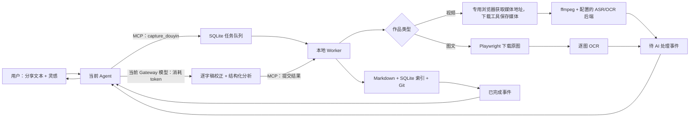

# Gateway Agent 接入指南

抖库默认使用 `analysis_mode = "gateway"`。接入的 Agent 是用户入口和 AI 执行者；
`douyin-wiki` Worker 是不持有会话的本地媒体处理与入库服务。

## 运行边界



本地执行且不消耗 AI token：链接解析、下载、音频提取、ASR、OCR、任务队列、Markdown、
索引和 Git。`gateway` 模式下只有视频逐字稿校正、作品分析以及 Gateway 给用户组织回复时使用
当前 Agent 模型并消耗 token。原视频和原图不会发给模型；模型只收到文字、OCR 和元数据。

## 调用边界与多客户端

本指南适用于通过 MCP 使用抖库的外部 Agent。仓库维护规则见[根 AGENTS.md](../AGENTS.md)，通用自助接入入口见 [docs/agents](agents/README.md)。应用生成的 Vault AGENTS.md 约束知识库文档，三者职责分别维护。

外部 Agent 默认使用 `tools/list` 返回的全部 MCP 工具，按用户任务和已有授权完成查询、采集、分析、博主、收藏与合集导入、专题、提醒、重分析及维护，不设置查询或采集角色白名单，不逐项重复询问已授权操作。

本项目源码由 Codex 维护。外部 Agent 对仓库只读，不修改源码、项目配置、测试、依赖或 Git 状态，不在其中创建配置、技能、脚本、日志或临时文件。生效配置和工作目录放在仓库外，STDIO 启动命令可指向仓库现有解释器，并禁止写入 Python 字节码。

接入时复用已有服务配置、Vault 和已登录浏览器 Profile，确认全部工具和共用规则实际加载；不能仅保存一个不会被读取的文件。全部工具开放不改变任务归属和工具参数要求，目录划分及提示词也不提供服务端鉴权或任务排他领取。

多个 Agent 接入时，每个客户端使用独立 `gateway` 标识，保存 `channel`、`conversation_id`、`message_id` 和 `reply_target`，并约定各自处理的任务和会话。只处理分配给自己的事件，其他事件跳过且不确认；提交前调用 `get_job` / `get_analysis_context` 重读最新阶段，成功处理或交付后再确认。轮询需逐页扫描未确认事件，即使整页属于其他客户端也继续翻页；重启、失败重试与游标处理见下文“事件接续”。

当前 `list_job_events` 只有游标、未确认和数量参数，会返回混合路由事件；`acknowledge_job_event` 只接收事件 ID。`gateway_context` 用于回传路由，不能据此宣称服务端已实现按 Agent 授权或任务排他领取。同一任务由一个明确的执行者处理，避免重复提交；其他客户端仍可使用全部工具处理自己的任务。

## MCP STDIO 配置

按[自助配置步骤](agents/self-setup.md)读取客户端实际版本与配置机制，再将[STDIO 启动契约](agents/integration-contract.md#stdio-启动契约)映射为原生配置。现有入口 `douyin-wiki-mcp` 保持；通用启动方式使用已安装的 Python、`-B -m douyin_wiki.mcp_server`、仓库外工作目录和显式的 `DOUYIN_WIKI_CONFIG`。

共用规范不规定某个客户端的配置文件或字段，也不在仓库保存生效配置。接入 Agent 自己发现和转换格式，开放服务返回的全部工具；不能把一份特定客户端示例当作所有 Agent 的配置。服务当前只支持 STDIO，其他传输能力不足时记录限制，不修改源码补适配层。

## Agent 必须执行的工具顺序

当用户提交抖音作品（可附灵感）时：

1. 调用 `capture_douyin`。`inspirations` 逐字传递，不得改写；同时传入
   `gateway_context`，至少包含 `gateway`，尽量包含 `channel`、`conversation_id`、
   `message_id` 和 `reply_target`。
2. 采集调用迅速返回 `job_id` 后，用进度消息告知用户，并继续执行同一任务。
   按下文[状态读取与等待规则](#当前任务内持续执行)查询简短状态或持久事件，下载或转写未结束时等待后再检查；
   不用完整任务记录反复轮询。`job_id` 是中间回执，不能因此结束任务或要求用户再发一次检查指令。
3. 视频进入“待 AI 处理”且阶段为“逐字稿校正”后，调用
   `get_analysis_context`。当前 Agent 根据原话上下文和对应 OCR 直接修复识别错误、同音字和断句；
   无依据的金额等保留原表述，不得摘要、删句或补写内容。只调用一次
   `submit_transcript_correction`，原始 ASR 和修改记录会保留。
   图文不会出现此阶段，而会直接进入“内容分析”。
4. 新任务校正后直接进入内容分析，不调用独立复核模型，也不要求用户逐条校对。若历史任务仍显示
   “需要人工复核”，仅在用户明确要求继续该任务时调用 `retry_job`，不可自动重跑历史任务。
5. 进入“内容分析”后，再次读取上下文，严格按本次 `analysis_schema` 一次完成分类和
   分析，并调用 `submit_gateway_analysis`。视频原话、图文正文、OCR、AI 推断和用户灵感不得混写；
   事实、数字、日期、参数与方法尽可能写成带时间戳或 `image_index` 的 `knowledge_atoms`。
6. 收到“已完成”或“已完成（有提示）”后，把一句话、AI 推断、提醒候选和原作品
   链接回复到 `gateway_context` 指向的原会话；需要补充结果详情时，按回执的 `entry_id` 读取一次 `get_entry`。
7. 每个事件成功处理或投递后调用 `acknowledge_job_event`。确认操作是幂等的。未确认的最新可操作
   事件会保留，可在 Gateway 重启后继续处理；同一任务已经过时的旧事件会自动标记为 superseded。

默认持续执行到完成（含提示）、失败、取消或确实需要用户输入。已授权的视频直接按正常流程处理，不按时长增加确认步骤。
缺少后台回投能力不妨碍在当前对话内检查状态和回复结果；只在对话结束后仍需继续处理时使用自动接续机制。

`get_analysis_context.media_provenance.asr` 的 `confidence_status` 表示分数可用性：
`unavailable` 为没有分数，`partial` 为部分字幕有分数，`available` 为每段都有分数；
均不代表已验证的正确率。`confidence_note` 是非阻塞说明。不要因缺少分数、低分、数字或识别歧义
创建人工复核疑点；当前 Agent 应根据上下文和对应 OCR 保守校正。OCR 未出现对应内容不等于冲突，
两个来源相同也不保证正确。历史未解决疑点只在用户明确要求继续时重试。

## 紧凑协议（gateway_protocol=2）

服务保留默认协议 1，调用方显式选择整数 `2` 才启用紧凑传输。它与分析结果的
`analysis_version=2` 是两个独立字段。状态查询可以单独使用 `get_job(..., gateway_protocol=2)`，
只需核对该工具的 schema 支持 `2`；这不要求校正和分析改用协议 2。校正和分析采用紧凑传输前，检查 MCP tool input schema：`get_job`、
`get_analysis_context`、`submit_transcript_correction`、`submit_gateway_analysis` 应都有
可选 `gateway_protocol`，枚举为 `[1,2]`，默认 `1`。旧服务没有该能力时使用完整旧流程，
不得用真实提交试探支持情况，也不能把增量补丁按协议 1 重放。

| 阶段 / 工具 | 协议 2 的材料与行为 |
| --- | --- |
| `get_analysis_context`，`phase=transcript_correction` | 完整原稿 `transcript`、OCR 投影、正文、逐字灵感、`correction_schema` 和材料版本；不检索既有知识 |
| `submit_transcript_correction` | 完整检查原稿，只提交有改动段的 `{id,text}`；`[]` 表示已检查且无需修改，也会生成完整校正稿并进入分析 |
| `get_analysis_context`，`phase=analysis` | `sources` 是分析输入正文，含有效校正稿、OCR、图文正文与定位；附既有知识和紧凑 `analysis_schema`，不重复发送全文副本 |
| `submit_gateway_analysis` | 接收紧凑 schema；可用编号恢复证据原文，也可使用显式引文；经原始材料校验后由 Worker 入库 |
| `get_job` 与两个提交回执 | 简短状态、`result` 摘要与链接、路由、错误及确认原因；不携带 `artifacts`、全文或 schema |

两次提交都必须带本阶段读取的 `context_revision`。校正成功后重新读取分析上下文，不能
因 `status` 相同而复用校正阶段版本。相同快照重读、重连可重建相同版本；材料、阶段或
任务更新后旧版本失效。版本绑定材料，不提供身份授权或排他领取；事件归属规则照常执行。

`sources` 每项为 `{kind,text,locations}`，同一 OCR 文字可以带多个实际位置。
位置中的 `source_ref` 在当前任务版本内有效：音频 `a:<segment_id>:<unit_index>`、
OCR `o:<observation_index>:<line_index>`、正文 `p:<unit_index>`。下标从 0 开始，
图片 `image_index` 仍从 1 开始。音频句子使用所属 ASR 段的实际时间，不能把单元位置当成更精确的句子时间。

`chapters[].evidence[]`、`knowledge_atoms[]`、`reminders[]` 可填写非空 `source_refs`。
服务端分别恢复 `quote` 与证据类型、`quote/provenance` 与定位、`source_quote`。
引用应有序、无重复、同类且连续；音频可跨相邻段，OCR 只能在同一原始 observation 内跨行，
正文可跨连续段落。不能跳过正文、跨图片或将音频/OCR 混成一组编号；混合来源继续用显式引文格式。
若同时提供引文、来源或定位，须与恢复结果一致；省略这些字段时由编号推导，不要填默认 `audio` 或 `null` 占位。
`provenance/evidence_type` 可省略，但出现时必须是对应来源枚举，不能为 `null`；紧凑 schema 不提供这两个字段的默认值。

非推断知识原子必须有编号，或有非空显式引文与合法定位。推断仍用
`atom_type=inference`、`provenance=ai_inference`，不能附编号。视频正文仅用于理解与提醒，
不能作为视频章节或知识原子证据；图文没有 chapters 时间轴，图片证据须有实际 `image_index`。
来源可定位不代表支持论断，Agent 仍须按原材料判断；既有知识不能充当本作品证据。

OCR 投影只去除附近精确重复字幕，并合并 60 秒内重复画面文字；原始字符、出现位置与后半片独有内容保留，
同文不会跨图片删除。没有全片 6000 字、20 条或图片数量截尾。客户端容量不足时报告限制，
不能遗漏后半片或图片完成分析；不改变 ASR/OCR 后端与采样方式。

以下示例中的任务、ID 与版本均须来自当前上下文；示例事实不能直接用于实际作品：

```json
{"job_id":"实际 job_id","gateway_protocol":2}
```

```json
{"job_id":"实际 job_id","gateway_protocol":2,"context_revision":"当前校正上下文的版本","corrections":[],"producer":"my-agent"}
```

```json
{"job_id":"实际 job_id","gateway_protocol":2,"context_revision":"当前分析上下文的版本","producer":"my-agent","analysis":{"title":"实际作品标题","knowledge_atoms":[{"id":"atom-1","statement":"从原文判断的实际事实","source_refs":["a:0:0"]}]}}
```

错误沿用 `invalid_job_state` 信封：`details.reason=context_revision_required` 表示缺版本，
`context_revision_mismatch` 表示版本失效，`invalid_source_ref` 表示引用格式、范围或字段冲突。
格式错误修正后可用仍有效的版本重新提交；版本失效必须重读当前阶段。错误只带必要路径、编号或当前版本，
不重传完整材料。成功后重放按阶段限制拒绝；丢失回执时先用紧凑 `get_job` 判断是否已推进。

等 Agent 的有效阶段 `next_tool=get_analysis_context`；已入队或处理中为 `list_job_events`；
完成后为 `null`，不要反复取完整材料。历史待确认任务的 `reason/duration_minutes`、授权 `auth_scope` 与
错误说明保留。`favorites_context/creator_context/collection_context` 的父任务和 `batch_silent` 保留；静默子任务
照常完成校正分析，成功处理或投递后才确认事件，不因紧凑回执自动确认。

紧凑协议减少应用往返正文，不保证固定计费 token 节省。实际用量取决于客户端如何保留历史和使用缓存；
真实客户端选择的协议、工具能力、材料版本与执行记录写在仓库外，不能只凭服务端已实现就记录已启用。

## 兼容协议示例（默认 gateway_protocol=1）

以下是 MCP 工具参数的最小示例。`job_id`、片段 `id` 和原会话路由须替换为刚读取的实际值；
视频先读 `get_analysis_context.phase`，图文和重新分析若直接返回 `analysis` 就跳过校正。
这里的示例文本只说明字段结构，不能直接当作作品分析结果提交。

```json
{"share_text":"https://www.douyin.com/video/7689429622975314067","inspirations":[],"gateway_context":{"gateway":"my-agent","channel":"chat","conversation_id":"conversation-123"}}
```

上面是 `capture_douyin`。协议 1 的视频 `submit_transcript_correction` 使用原始逐字稿中的全部实际 ID，
每项 `text` 必须保留完整内容；未修改的片段也必须显式回传原文。缺段、重复 ID、未知 ID
都会拒绝；仅当原稿为空时允许 `corrections=[]`。进入 `analysis` 后不可再次提交校对。
并发提交遇到任务已更新时，重新读取上下文和阶段，不要盲目重放旧结果。旧客户端仍可传 `review_issues`，但仅作为校正说明保留，
不会暂停新任务。不要为新任务填充该参数。旧格式例：

```json
{"id":"agent-0","start_ms":0,"end_ms":41870,"raw_text":"待核实的完整原句","reason":"专有名词待核实","suggestions":["完整候选原句"]}
```

`Service` 直调需要 `TranscriptCorrection` / `ReviewIssue` 实例，MCP 工具包装层会校验并转换 JSON：

```json
{"job_id":"实际 job_id","corrections":[{"id":0,"text":"完整校正后的第 0 段原话"}],"producer":"my-agent","model":"当前模型"}
```

分析请求应以本次 `get_analysis_context.analysis_schema` 为准。以下 `other` 类型的
`content_card.notes` 是字符串数组；若改用 `recommendation`，`criteria` 也必须是数组。
没有可核验证据时保持 `knowledge_atoms`、`chapters` 等为空，不能伪造事实或时间戳：

```json
{"job_id":"实际 job_id","producer":"my-agent","model":"当前模型","analysis":{"analysis_version":2,"title":"示例标题","one_liner":"示例一句话","relevance_to_inspiration":"","takeaways":[],"content_type":"other","facets":[],"content_card":{"kind":"other","notes":[]},"chapters":[],"knowledge_atoms":[],"actions":[],"open_questions":[],"reminders":[],"tags":[],"concepts":[],"entities":[],"contradictions":[]}}
```

`tags` 只根据本篇的中心内容生成，不提供或参考已有标签清单。通常两个，最多三个；
中心不够时可少写或为空。第一个写具体中心对象，第二个写所讨论的问题、方法或判断，
第三个只用于另一个同等重要的中心。中心对象可以是 FDE、Data Agent 等专名，
但顺带提到的产品、类比和例子不能作为标签，也不要用“AI”等背景词凑数。
新分析提交时去除首尾空白、丢弃空标签并按原顺序去重，仍超过三个就拒绝；
这个限制也适用于 `submit_analysis`，旧资料读取与索引保持兼容。
落库仍解析用户已经确认的合并别名，不做语义近似归类。

“需要登录授权”表示采集使用的浏览器需要登录或验证码。本机 Worker 通常已经
显示 macOS 授权引导；用户完成登录后，抖库会验证授权并自动重试相同授权通道中仍然暂停的任务。
Gateway 应先调用 `get_auth_status` 和 `get_job` 复核最新状态，不要反复打开浏览器或重复调用
`retry_job`。

**状态字段约定（程序判断用机读码）**：MCP/`get_job` 同时返回英文机读码 （`status` / 事件里的状态）和中文展示字段（`status_label`、`state_label`、`stage_label` 等）。Agent 轮询与分支判断必须用英文机读码（如 `awaiting_agent_analysis`、历史 `needs_review`）；面向用户回复时只用中文 label，不要用中文 label 做相等判断。若用户选择稍后处理、引导超时或本机弹框不可用，再按任务中的 `auth_scope` 提供手工登录步骤：
优先在仓库外工作目录、沿用服务配置环境运行 `<PYTHON_EXECUTABLE> -B -m douyin_wiki auth douyin`，完成视频主路径、图文、博主、收藏和合集共用的专用浏览器授权。
`<PYTHON_EXECUTABLE> -B -m douyin_wiki auth video` 只为 yt-dlp 最后回退准备系统浏览器 Cookie；确认对应路径授权成功后再调用 `retry_job`。
不得要求用户提供 Cookie；状态接口也不会返回 Cookie 值。

旧版本留下的 `waiting_confirmation` 任务仍可调用 `approve_job` 恢复；已有授权覆盖继续处理时直接执行，不重复询问。

提醒候选不会自动写入 macOS。用户任务或已有授权覆盖创建提醒，且时间已解析为绝对时间时，调用
`confirm_reminder` 并传 `confirmed=true`，不因工具名包含“确认”再次询问。缺少具体内容或时间时才补充输入；重复调用会返回同一个系统提醒 ID。

对已有资料调用 `reanalyze_entry` 或 `reanalyze_all` 时会直接复用校正逐字稿和 OCR，事件从
“内容分析”开始，不需要再次校正，也不会触发下载、ASR 或 OCR。默认跳过 v2 条目，
只有显式 `force=true` 才重新生成。

## 博主选择式批量采集

用户提交博主主页或该博主任意作品时，先调用 `capture_douyin_creator`，并逐字传递博主灵感。
本地 Worker 完成主页清点后，父任务进入“待选择作品”：

1. 调用一次 `get_creator_inventory` 读取全部作品，并在同一条回复中展示固定编号、封面、标题、
   视频/图文类型、时长和发布时间。只有超大清单且用户明确接受分页时才传 `page/limit`。
2. 根据用户已给出的范围、类型、时间或标题条件直接选择作品，用稳定编号或作品 ID 调用
   `set_creator_work_selection`，分别写入“已选入库”与“未入库”。决定保存在 SQLite，不能只记在
   对话上下文里。
3. 还有“待入库”作品时先按已有条件完成选择。汇总待入库、已选入库、未入库和已入库数量后直接执行导入，不重复确认已给出的选择。
   清单不完整时，已有授权覆盖部分导入即可传 `accept_partial=true`；否则补充这项会改变范围的决定。
4. 调用 `confirm_creator_import` 后才会建立采集子任务。子任务沿用视频/图文的校正与分析流程；
   当事件含 `creator_context.batch_silent=true` 时完成 AI 工作但不逐条刷屏，等待父任务汇总。
5. 用户要重新采集之前跳过的作品时，调用 `import_creator_works`。

用户任务包含博主同步时调用 `sync_creator`，不重复询问已授权的同步目标。它会完整重新清点并只把新增作品放入新一轮
选择清单；没有新增时返回“同步完成：没有发现新作品”。任务包含定期同步时由客户端安排，普通一次性同步不扩展为长期订阅。
每个博主的新增资料都写入独立的 `creators/<博主名_短ID>/` 目录，旧资料保持原位并由博主索引链接。

## 合集选择式批量采集

用户提交合集分享文案或 `/collection/{mix_id}` 链接时，调用 `capture_douyin_collection` 并传递原会话 `gateway_context`。清点不下载视频，短链即使继续导航到第一集也保留原合集范围。

1. 等父任务进入 `needs_selection`，调用 `get_collection_inventory` 读取全部清单；不传 page/limit 时不会截成第一页。展示名称、读取是否完整、作品编号及实际数量。
2. 根据已有范围调用 `set_collection_work_selection`，`decision` 为 selected 或 skipped，ordinals、work_ids、all_works 三选一。用户明确要求全部入库时使用 `all_works=true`；部分导入先跳过其他可导入作品。编号为本轮 ordinal，不一定等于集数。
3. 每件可导入且尚未入库的作品都有决定后，调用 `confirm_collection_import`。已有授权覆盖完整清单时直接执行；部分清单需要已有授权覆盖 `accept_partial=true`，否则补充这项范围决定。重复确认不会重复创建任务，选项冲突会拒绝整批。
4. 本地 Worker 和当前模型继续完成各 capture 的转写、校正、分析与入库。`collection_context.batch_silent=true` 的新子任务不逐条刷屏；复用任务保留原 Gateway 路由与通知行为。等待其他 Gateway 时父任务仍为 monitoring，不能提前回复整批成功。
5. 用父任务查询汇总成功、已有、失败和取消；失败项调用 `retry_collection_import`。需要再清点时创建新批次，新增作品不会自动继承旧选择。

`get_collection/list_collections` 查询持久知识关系，`list_collection_imports` 查询操作历史。合集索引引用已有资料目录，清理批次历史不会删除知识关系。详细参数及验证边界见[合集导入](collections-import.md)。

## 事件接续

### 当前任务内持续执行

Agent 收到 `job_id` 后保持当前任务运行，使用 `get_job` 和 `list_job_events` 检查进度。
先核对 `get_job` 的 input schema：支持 `gateway_protocol=2` 时，所有状态查询都显式传入 `2`，
只读取简短状态、阶段和回执；这个选择独立于校正、分析所用的协议。默认协议 1 会返回包含逐字稿和 OCR 的完整任务记录，
不用于反复轮询。旧服务不支持简短状态时，以持久事件为主要等待入口，必要时才读取完整任务以核对状态或恢复阶段，
不向旧服务传入不支持的参数。只有进入校正或分析阶段时才读取完整的阶段上下文。
任务尚未进入可操作阶段时使用客户端的等待能力，并逐步延长检查间隔，避免无间隔重复调用。
待校正或分析时读取最新上下文并提交，完成后在当前对话直接回复结果。当前对话没有 `reply_target`
不等于不能回复；仅填写实际可获得的路由字段，不猜造会话或消息平台标识。

没有新事件不代表任务已结束，仍需核对任务状态。`completed`、`completed_with_warnings`、`failed` 和 `cancelled`
都是终态，即本轮处理已经结束；回复对应结果并按事件确认规则处理本任务的事件后，停止该任务的轮询和自动接续。
用户取消的任务不自动调用 `retry_job` 恢复。确实缺少用户输入时报告所需输入并暂停跟进。
遇到客户端执行时长或轮数限制时，优先交给已有的自动接续机制，避免把再次手动触发作为正常使用步骤。

### 对话结束后的自动接续

`list_job_events` 是持久事件游标，不是内存通知。它支持 `after_event_id`、只返回未确认事件，
并携带原始 `gateway_context`。没有 `gateway_context` 的 CLI 任务不会进入投递队列。写入事件本身不会启动 Agent；
只有需要在对话结束后继续处理时，才由客户端提供自动续跑、会话心跳、定时任务或事件桥。
会话心跳是在会话空闲后自动发起下一轮检查的客户端功能，与 Worker 的运行状态记录不同。
调度归客户端管理，不作为普通采集的接入前提。优先复用客户端已有机制，可选择：

- 在支持后台任务续跑时，把 `job_id` 交给 Gateway 自身的后台任务；
- 使用客户端的会话心跳或定时任务调用 `list_job_events`；
- 使用无 Agent 的本地定时器运行现有 `jobs events` 分页入口，再由 Gateway 的事件桥
  唤醒一次 Agent。

#### 客户端原生自动接续

使用前两种方式时，将指定 `job_id` 与实际可用的原会话绑定，沿用上述简短状态查询、事件归属和终态停止规则。
核对客户端能恢复指定任务并交付结果即可，无需另配常驻监控器、脚本或定时器。会话心跳与自动续跑可能调用模型，
是否消耗 token 以客户端实际执行方式为准。

#### 自建事件桥（可选）

最后一种方式的“事件桥”属于 Agent 的部署配置，不由本项目自动安装。以下步骤和伪代码只适用于选择自建事件桥的实例，
不作为客户端原生自动接续的前提。该桥的空轮询只运行本地命令、不调用模型；有可操作事件时才唤醒 Agent：

1. 配置上面的 MCP STDIO server，并让 Agent 能访问 `list_job_events`、`get_job`、
   `get_analysis_context`、提交、复核和 `acknowledge_job_event` 工具。
2. 配置一个随 Agent 启动并持续运行的无模型监控任务，在仓库外工作目录沿用服务启动环境逐页执行
   `<PYTHON_EXECUTABLE> -B -m douyin_wiki jobs events --after-event-id <cursor> --limit 100`，或使用等价的
   `list_job_events(after_event_id=cursor, unacknowledged_only=true, limit=100)` 调用。
   每轮从 `cursor=0` 开始，按整页最后一个事件的 ID 推进；即使本页事件全部属于其他客户端，
   也继续翻页，直到返回空数组。CLI 空页输出 `[]`，不能用“stdout 是否为空”判断。
   只唤醒分配给当前 Gateway/会话的事件，并按 `gateway_context` 路由到原会话。
   不要只依赖“输出变化”触发：处理或交付失败时保留未确认，按失败次数有界重试并退避，
   同时继续扫描本页其他事件及后续页。每轮和重启后重新从头扫描，
   不跨轮持久化 `after_event_id` 高水位，以免跳过早先失败的未确认事件。
   CLI 输出用于事件 ID 和路由；判断业务状态时读取 MCP `get_job` 返回的英文 `status` 与
   `get_analysis_context.phase`，不要将 CLI 的中文显示状态或 label 与内部状态码比较。
3. Agent 处理每个事件前按上述状态读取规则查询任务，核对任务仍处于该事件对应的可操作阶段；
   仅在当前任务需要 AI 处理时调用 `get_analysis_context` 读取最新 `phase` 和 schema，终态事件直接处理结果。
   `awaiting_agent_analysis`
   可能先后对应 `transcript_correction` 和 `analysis`，状态相同也要处理新事件。
4. 按当前阶段调用工具，成功提交或成功交付原会话后才确认事件。提交或交付失败时保留未确认，
   供下一轮及重启后重试；不要先确认。以事件 ID、job ID 和 phase 识别重复投递，
   但仍在提交前重读当前阶段，已推进的阶段不再重复提交。这是可重试投递，不保证恰好一次执行。
   过时事件会标记 `superseded`，默认监控只返回仍可操作的未确认事件。

以下是自建事件桥的伪代码；`read_job_status` 按上述 schema 检查选择简短状态或兼容读取，实际唤醒与消息投递 API 由客户端提供：

```text
every polling interval:
    cursor = 0
    while true:
        output = run_without_model(
            [PYTHON_EXECUTABLE, "-B", "-m", "douyin_wiki", "jobs", "events",
             "--after-event-id", str(cursor), "--limit", "100"],
            cwd=EXTERNAL_WORK_DIR, env=SERVER_ENV
        )
        if command failed or output is not a valid JSON array: retry with backoff; return
        events = parse_json(output)
        if events is empty: break
        cursor = events[-1].id  # advance past the whole page, including skipped events
        for event in events:
            if event is not assigned to this Gateway/conversation: continue
            if event is waiting for its retry backoff: continue
            try:
                job = read_job_status(event.job_id)
                if event is obsolete for job: continue
                if job requires AI:
                    context = mcp.get_analysis_context(event.job_id)
                    process current context.phase, preserving batch_silent
                else:
                    process current job result; deliver to event.gateway_context unless batch_silent
                mcp.acknowledge_job_event(event.id) only after successful processing/delivery
                if job.status in {completed, completed_with_warnings, failed, cancelled}:
                    stop following this job; keep other jobs and shared scheduler running
            on processing, delivery or MCP failure:
                leave event unacknowledged; schedule bounded retry with backoff; continue
```

Hermes 可按实际版本选择[持续目标](https://hermes-agent.nousresearch.com/docs/user-guide/features/goals)、
[会话心跳](https://hermes-agent.nousresearch.com/docs/user-guide/features/heartbeat)或
[定时任务](https://hermes-agent.nousresearch.com/docs/user-guide/features/cron/)。分别核对当前任务执行、空闲后的自动唤醒和结果投递，不能因缺少某一种回投方式就认定客户端无法持续执行。

自动接续只跟进指定任务，任务完成（含提示）、失败或取消并交付结果后停止该任务的跟进；
不停止其他任务或客户端共用调度。状态没有变化时不反复通知用户。
客户端确实无法在对话结束后恢复时如实报告限制，不将其写成所有桌面客户端都必须手动检查。

自建事件桥使用上述伪代码执行无模型分页扫描，CLI 入口为 `jobs events`，
在仓库外工作目录运行并沿用服务的配置环境。兼容命令 `douyin-wiki gateway monitor-events` 在没有未确认事件时
不输出任何内容，有事件时固定返回最早的 100 条；它只作单页探测，不能代替完整分页扫描。
选用 Hermes 时可用 `hermes mcp test douyin-wiki` 检查 MCP；只有使用 Hermes cron 接续时才检查相应定时任务：

```bash
hermes cron list
hermes cron runs --limit 10
```

## 推荐 Gateway 系统指令

可把以下内容加入负责此知识库的 Agent 指令：

```text
使用 tools/list 返回的全部抖库 MCP 工具，按用户任务和已有授权执行，不逐项重复审批。
抖库源码由 Codex 维护，本 Agent 对仓库只读；所有配置、技能、脚本、日志和临时文件放在仓库外。
复用已有抖库配置、Vault 和已登录浏览器 Profile。
用户提交抖音作品时调用 capture_douyin；灵感没有提供时不强求，有提供时必须逐字传递。
只处理分配给当前 gateway/会话的事件，其他事件跳过且不确认；提交前重新读取任务和阶段。
capture 时保存实际可获得的 gateway/channel/conversation/message 路由，不猜造缺失字段。
收到 job_id 后用进度消息告知用户，继续等待并检查状态或事件，不结束任务、不要求用户再发检查指令。
先核对 get_job 的 schema；支持 gateway_protocol=2 时所有状态查询显式传 2，与校正和分析所用协议独立。
默认完整 get_job 不用于反复轮询；旧服务以持久事件为主要等待入口，必要时兼容读取完整任务。
视频直接按正常流程处理，不按时长增加确认或提示。
任务进入“待 AI 处理”后，视频先校正逐字稿，图文直接按返回的 schema 分析；
不得改写灵感，不得把 AI 推断当作作品原话。历史任务按用户目标和已有授权处理，不重跑无关任务。
“需要登录授权”时先调用 get_auth_status 和 get_job，等待本机授权引导完成并复核最新状态；
只有自动引导未完成时，才根据授权范围提示用户运行 auth video 或 auth douyin，授权成功后再重试。
完成后把原作品链接、摘要、灵感关联、时间戳或图片编号证据和提醒候选发回原会话。
成功处理每个 job event 后确认该事件。
当用户要求保存某个博主时，调用 capture_douyin_creator，先展示清单并把用户的选择逐项写入；
所有作品选中或跳过后调用 confirm_creator_import；同步属于用户任务时调用 sync_creator。
用户已给出作品选择、同步范围或其他操作目标时直接调用相应工具，不因确认工具名称再次询问。
持续执行到完成（含提示）、失败、取消或确实需要用户输入；收到终态并交付结果后停止该任务的跟进，取消后不自动重试。
只有需在对话结束后继续时才使用客户端自动接续机制；原生自动接续无需额外常驻监控器，自建事件桥单独配置。
```

## 调试

下列命令中的解释器需替换为实际路径，在仓库外工作目录执行，并沿用 MCP 的配置环境：

```text
<PYTHON_EXECUTABLE> -B -m douyin_wiki jobs events
<PYTHON_EXECUTABLE> -B -m douyin_wiki gateway context JOB_ID
<PYTHON_EXECUTABLE> -B -m douyin_wiki jobs get JOB_ID
```

如果任务已完成但 Gateway 没有回复，先看未确认事件中是否保留了正确的
`conversation_id`/`reply_target`。如果任务停在“待 AI 处理”，说明本地媒体处理已经
完成，等待 Gateway 调用校正或分析提交工具，而不是 Worker 故障。
